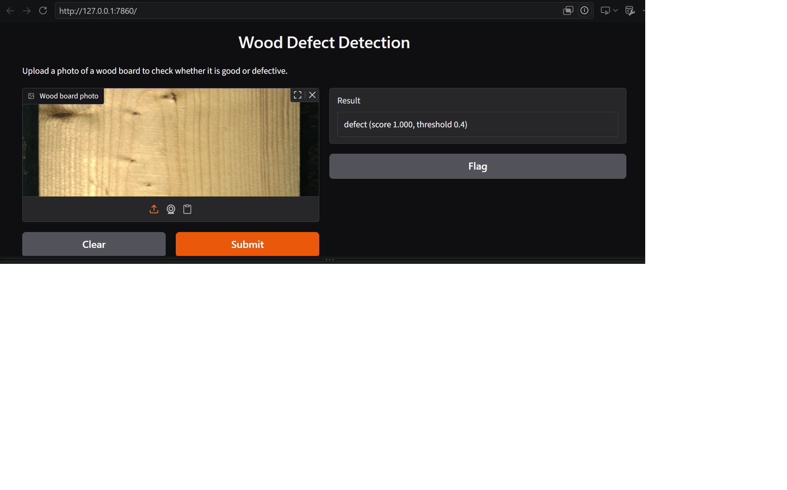

# Wood Defect Detection

Deep learning model that classifies wood boards as good or defective, with a Gradio demo app.

## Demo



The app takes a photo of a wood board and returns "good" or "defect" with a score (threshold 0.4).

## Error analysis (20 sample boards: 18 correct)

- defect_5.jpg (true: defect, predicted: good, score 0.366). The board shows only small, low-contrast marks (a tiny brown spot, a thin streak, and small surface bumps), which are easy to lose when the wide image is downscaled from 2800x1024 to 512x192 pixels.
- good_2.jpg (true: good, predicted: defect, score 0.637). The board contains a visible knot, which the model likely associates with defects.

Next steps: crop the black borders, test a higher input resolution, and review how the dataset labels small knots.

## Dataset

The model was trained on the public wood surface defects dataset by Kodytek, Bodzas and Bilik, hosted on Kaggle (about 20.3k files, 4.42 GB, CC0 public domain license).

Citation: Kodytek P, Bodzas A, Bilik P. A large-scale image dataset of wood surface defects for automated vision-based quality control processes. F1000Research 2021, 10:581. https://doi.org/10.12688/f1000research.52903.1

## Results

Labels: a board counts as "defect" if it has at least one annotated box (including knots), and as "good" if it has none. Split: random 70/15/15 (stratified, seed 42). The test set has 3,042 boards the model never trained on (299 good, 2,743 defect). Model: EfficientNetB0 with transfer learning, input 512x192 pixels, decision threshold 0.4.

| | Predicted good | Predicted defect |
|---|---|---|
| Actually good (299) | 275 | 24 |
| Actually defect (2,743) | 93 | 2,650 |

- Test AUC: 0.988
- False alarms: 24 of 299 good boards (8%)
- Missed defects: 93 of 2,743 (3.4%)
- Weakest defect types (recall): blue stain 0.69 (13 boards), quartzity 0.89, crack 0.92. Knots, resin and marrow are all at 0.97 or higher.

### Limits

- About 90% of the test boards are defective, so plain accuracy (96%) is misleading: always answering "defect" would already score 90%. Precision on good boards (0.75) is the more honest number.
- The threshold of 0.4 was picked from a table of missed defects against false alarms. That table was printed for both the validation and test sets, so the test numbers are slightly optimistic.
- The split is random by image. A quick check found no near-identical boards across train, validation and test, but it was a coarse check.
- In this dataset, "defect" includes any annotated knot, so the label depends on the dataset's annotation rules.

## How to run

Tested with Python 3.12 on Windows.

```
git clone https://github.com/singhangaddeep63-del/wood-defect-detection.git
cd wood-defect-detection
python -m venv venv
venv\Scripts\activate
pip install -r requirements.txt
```

Download `wood_model_20k.keras` from the Releases page of this repository and put it in the project folder, next to `README.md`. The model file is not stored in the repository because of its size.

Start the demo app:

```
python app\app.py
```

Then open http://127.0.0.1:7860 in your browser.

To classify a whole folder of images and save the results to `predictions.csv`:

```
python src\predict.py "path\to\your\images"
```
## Training

The model was trained on Google Colab with a GPU. The full code is in [notebooks/03_train_wood20k.ipynb](notebooks/03_train_wood20k.ipynb). The final training run is the large cell that starts with `# ---- GPU and Drive ----`. The cells after it are experiments (duplicate check, flip averaging, and a higher-resolution run at 256x704 pixels).
